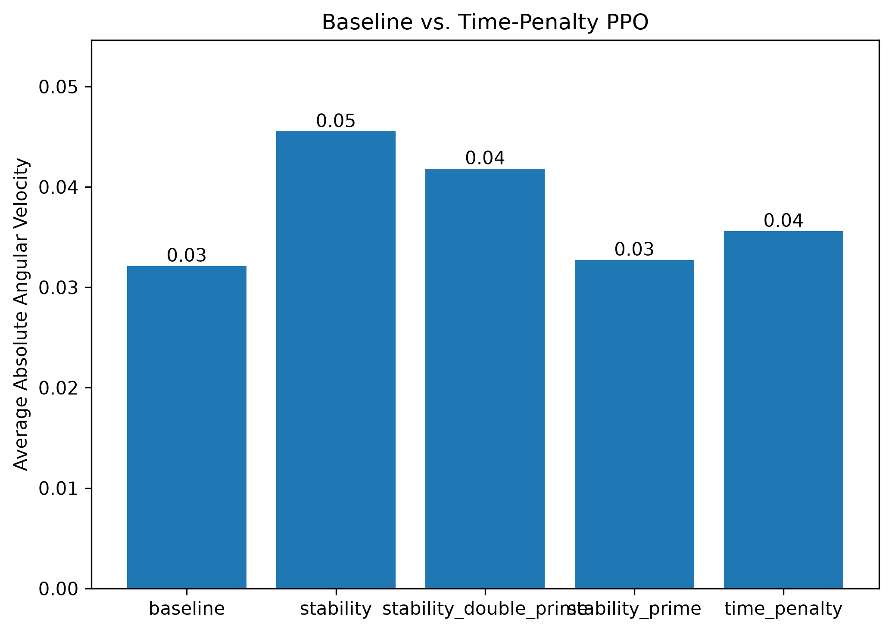

# Rocket Landing with Reinforcement Learning

Training and evaluating reinforcement learning agents to land a simulated rocket using Proximal Policy Optimization (PPO), custom reward shaping, and flight trajectory analysis.

## Project Overview

This project investigates how reward function design affects the performance of reinforcement learning agents in the Gymnasium `LunarLander-v3` environment.

Using Python and Stable-Baselines3, I trained **five PPO agents** with different reward configurations and compared their landing performance, episode efficiency, and rotational behavior.

The project explores a central challenge in reinforcement learning: **optimizing a reward function does not necessarily produce the intended behavior.**

## Technologies Used

- **Python** — Training, evaluation, and data analysis
- **Gymnasium** — LunarLander-v3 simulation environment
- **Stable-Baselines3** — PPO reinforcement learning implementation
- **PyTorch** — Neural network training backend
- **NumPy and Pandas** — Trajectory analysis and performance metrics
- **Matplotlib** — Performance visualization

## How It Works

The LunarLander environment simulates a spacecraft attempting to land safely on a designated landing pad.

At each timestep, the agent observes eight state variables, including position, velocity, orientation, angular velocity, and landing-leg contact states.

The agent selects one of four discrete actions:

- Do nothing
- Fire the left orientation engine
- Fire the main engine
- Fire the right orientation engine

PPO learns a control policy by interacting with the environment and optimizing cumulative rewards.

## Training Configuration

All five agents were trained using the same PPO hyperparameters:

| Parameter | Value |
|---|---|
| Algorithm | PPO |
| Policy | MlpPolicy |
| Environment | LunarLander-v3 |
| Training Timesteps | 500,000 per model |
| Learning Rate | 0.0003 |
| Rollout Steps | 2,048 |
| Batch Size | 64 |

Each model was evaluated deterministically over 100 episodes using the same environment seeds. Evaluation used the original environment reward to ensure that results from differently shaped training rewards remained comparable.

## Reward Shaping Experiments

### Model 1: Baseline PPO

Trained using the default LunarLander reward function, without additional penalties.

This model provides a reference for evaluating the effects of reward shaping.

### Model 2: Time-Penalty PPO

Introduced a small penalty for each simulation step:

```python
reward -= 0.01
```

**Hypothesis:** Penalizing time will encourage the agent to complete episodes more efficiently.

### Model 3: Stability PPO

Combined the time penalty with a penalty proportional to absolute angular velocity:

```python
reward -= 0.01
reward -= 0.02 * abs(observation[5])
```

**Hypothesis:** Penalizing rotation will encourage more stable flight behavior while maintaining efficient landings.

### Model 3′: Strong Stability PPO

Increased the rotational penalty by a factor of 10:

```python
reward -= 0.01
reward -= 0.20 * abs(observation[5])
```

**Hypothesis:** A stronger penalty will reduce angular velocity more effectively, potentially at the expense of landing performance.

### Model 3″: Intermediate Stability PPO

Tested a coefficient between the original and stronger penalties:

```python
reward -= 0.01
reward -= 0.05 * abs(observation[5])
```

**Hypothesis:** An intermediate coefficient may provide a better trade-off between rotational stability and overall performance.

## Experimental Results

### Performance Comparison

| Model | Average Reward | Preliminary Success Proxy | Average Steps | Average Absolute Angular Velocity | Average Maximum Angular Velocity |
|---|---:|---:|---:|---:|---:|
| Baseline | 115.85 | 72% | 498.54 | 0.0321 | 0.4826 |
| Time Penalty | 189.40 | 76% | 382.86 | 0.0356 | 0.4828 |
| Stability (3) | **204.90** | 79% | **321.00** | 0.0455 | 0.6242 |
| Strong Stability (3′) | 53.76 | 48% | 417.68 | 0.0327 | 0.5364 |
| Intermediate Stability (3″) | 167.93 | **81%** | 423.96 | 0.0418 | 0.5490 |

**Evaluation note:** The preliminary success proxy is based on episode termination and final-step reward. It has not been validated as an exact landing-success detector.

### Performance Visualizations

#### Average Episode Reward


#### Preliminary Success Proxy


#### Average Episode Length


#### Average Absolute Angular Velocity



## Key Findings

### 1. Reward Shaping Improved Observed Performance

Model 3 achieved an average reward of 204.90, a **76.9% increase** over the baseline, while reducing average episode length by **35.6%**.

These results demonstrate that the reward configuration can substantially affect the learned policy.

### 2. Penalizing Rotation Did Not Initially Reduce Rotation

Despite receiving an explicit angular-velocity penalty, Model 3 exhibited higher average angular velocity than both the baseline and time-penalty models.

This unexpected result motivated further investigation into the agent's control behavior.

### 3. Flight Trajectory Analysis Revealed Different Control Patterns

I analyzed 100 evaluation trajectories per model, recording angular velocity, engine actions, and flight progress.

Model 3 exhibited greater angular velocity primarily during the first 80% of episode progress.

Although Models 2 and 3 activated their orientation engines at similar overall rates (42.33% and 43.32% of steps, respectively), Model 3 maintained longer consecutive orientation-engine action sequences.

During multi-step runs of identical orientation-engine actions, absolute angular velocity increased in **66.81%** of Model 3's runs, compared with **33.91%** for Model 2.

These observations suggest that differences in action timing and control patterns may contribute to Model 3's higher rotation, although they do not establish a definitive causal explanation.

### 4. Stronger Penalties Reduced Rotation but Hurt Performance

Increasing the rotational penalty coefficient from `0.02` to `0.20` reduced average angular velocity by **28.1%**.

However, average reward decreased by **73.8%**, demonstrating a substantial observed trade-off between rotational stability and overall performance.

### 5. Intermediate Penalties Produced Different Trade-offs

Using an intermediate coefficient of `0.05` reduced average angular velocity by **8.1%** compared with Model 3.

Model 3″ also achieved the highest preliminary success proxy (81%), but its average reward and episode efficiency were worse than Model 3's.

These findings illustrate that no single tested configuration performed best across every metric.

## Limitations

- Each reward configuration was trained once; repeated training with different random seeds is needed to assess consistency.
- The preliminary landing-success proxy has not been validated against actual landing outcomes.
- Differences in behavior may reflect both reward shaping and stochastic training variation.
- The tested penalty coefficients do not establish an optimal reward function.

## Installation and Usage

### 1. Clone the repository

```bash
git clone https://github.com/arnavlasher/rocket-landing-rl.git
cd rocket-landing-rl
```

### 2. Create a virtual environment

```bash
python -m venv .venv
```

Activate the environment on Windows:

```powershell
.venv\Scripts\activate
```

### 3. Install dependencies

```bash
pip install -r requirements.txt
```

### 4. Train the models

Train the baseline model:

```bash
python train.py
```

Train the reward-shaped models:

```bash
python train_custom.py
python train_stability.py
python train_stability_prime.py
python train_stability_double_prime.py
```

### 5. Evaluate model performance

```bash
python evaluate.py
```

This evaluates all five models and saves performance metrics to the `results/` directory.

### 6. Generate comparison plots

```bash
python plot_comparison.py
```

### 7. Analyze agent behavior

Run the additional behavioral analyses:

```bash
python analyze_trajectories.py
python analyze_rotation.py
python analyze_actions.py
python analyze_engine_patterns.py
python analyze_rotation_buildup.py
```

These scripts examine flight trajectories, angular velocity, orientation-engine usage, and rotational behavior.

## Future Improvements

- Validate landing outcomes using explicit touchdown criteria.
- Repeat training across multiple random seeds and report statistical uncertainty.
- Explore alternative reward functions that better balance stability and landing performance.
- Investigate reward hacking and unintended agent behavior.
- Compare PPO with other reinforcement learning algorithms.

## Conclusion

This project demonstrates how reinforcement learning performance depends on reward design and how reward shaping can produce unexpected behavioral trade-offs.

By training five PPO configurations, evaluating their performance, and analyzing flight trajectories, I investigated the relationship between landing efficiency, rotational stability, and learned control strategies.

The results highlight the importance of evaluating both task performance and actual agent behavior rather than relying on reward scores alone.
