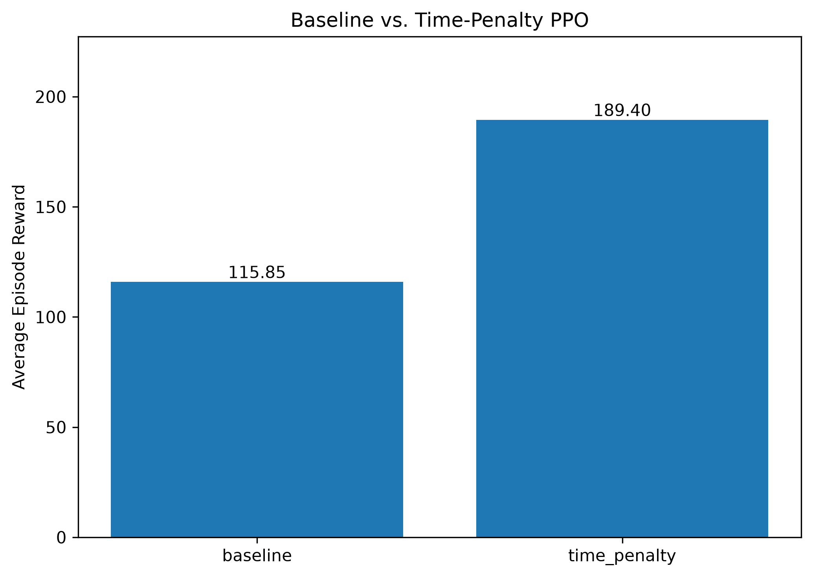
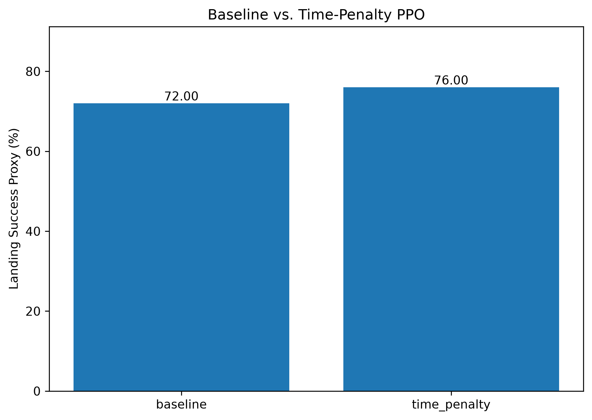
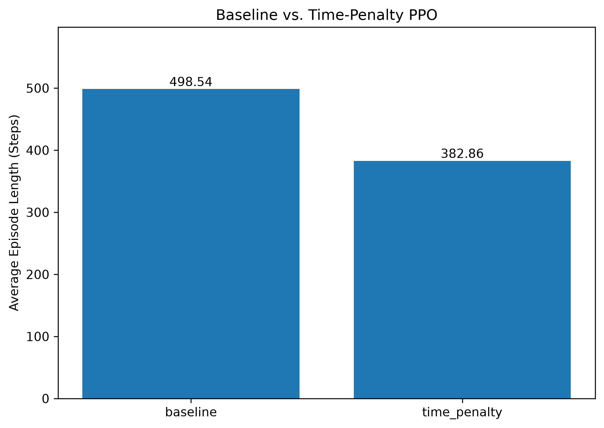

# Autonomous Rocket Landing Using Reinforcement Learning

A reinforcement learning project that trains an AI agent
to autonomously land a rocket in Gymnasium's LunarLander-v3
environment using Proximal Policy Optimization (PPO).

## Technologies
- Python
- Gymnasium
- Stable-Baselines3
- PyTorch
- Matplotlib
- Pandas

## Baseline Model
- Algorithm: PPO
- Training timesteps: 500,000
- Evaluation episodes: 100
- Average reward: 115.85
- Landing success proxy: 72%
- Average episode length: 498.5 steps

## Baseline Evaluation

## Reward Shaping Experiment: Time Penalty

To investigate the effect of reward shaping on reinforcement learning performance, I trained two PPO agents for 500,000 timesteps each:

- **Baseline PPO:** Uses Gymnasium's default reward function.
- **Time-Penalty PPO:** Applies an additional penalty of 0.01 for every simulation step.

Both models were evaluated over 100 episodes using identical environment seeds and the original Gymnasium reward function.

## Stability Reward Shaping Experiment

### Objective

After introducing a time penalty in Model 2, the PPO agent achieved a higher average reward and completed episodes in fewer steps than the baseline.

The next experiment investigated whether explicitly penalizing excessive angular velocity could further improve landing performance.

The goal was to encourage the agent to maintain greater rotational stability while preserving the time-efficiency incentive introduced in Model 2.

### Hypothesis

Combining a per-step time penalty with an angular-velocity penalty would encourage smoother landing approaches, potentially improving average reward, landing reliability, and episode efficiency.

### Implementation

A custom `StabilityRewardWrapper` was implemented using Gymnasium's wrapper API.

The wrapper modifies the reward returned after each environment step:

$$
R_{\text{stability}} = R_{\text{original}} - 0.01 - 0.02|\omega|
$$

Where:

- `R_original` is Gymnasium's original environment reward.
- `0.01` is the constant time penalty applied each step.
- `0.02` is the angular-velocity penalty coefficient.
- `ω` represents the lander's angular velocity.

The angular velocity is obtained from `observation[5]` in the LunarLander-v3 observation space.

The wrapper was implemented in `reward_wrappers.py`, and the agent was trained using `train_stability.py`.

### Experimental Setup

To maintain consistency with the previous experiments, the stability model used the same PPO training configuration:

| Parameter | Value |
|---|---|
| Algorithm | PPO |
| Policy | MlpPolicy |
| Training Timesteps | 500,000 |
| Learning Rate | 0.0003 |
| Rollout Steps | 2048 |
| Batch Size | 64 |
| Time Penalty | 0.01 |
| Stability Penalty | 0.02 |
| Evaluation Episodes | 100 |

The stability model was evaluated using the same environment seeds and original reward function as the baseline and time-penalty models.

### Experimental Results

| Metric | Time-Penalty PPO | Stability PPO | Improvement |
|---|---:|---:|---:|
| Average Episode Reward | 189.40 | **204.90** | +8.2% |
| Landing Success Proxy | 76% | **79%** | +3 percentage points |
| Average Episode Steps | 382.86 | **321.00** | −16.2% |

The stability-shaped model outperformed the time-penalty model across all three measured metrics.

Compared with the original baseline, the stability model achieved:

- **76.9% higher average episode reward**
- **7 percentage-point higher landing-success proxy**
- **35.6% fewer simulation steps per episode**

### Analysis

The results suggest that combining time-based and angular-velocity reward shaping may improve the agent's landing performance.

The stability model achieved an average reward of **204.90**, exceeding the commonly referenced LunarLander performance threshold of 200.

Additionally, the reduction in average episode length suggests that the additional stability penalty did not prevent the agent from completing episodes efficiently.

However, these results do not independently establish that the agent learned smoother flight trajectories. Confirming that would require measuring angular velocity throughout each episode.

The experiment also used a single training run per configuration, so additional runs with different random seeds are necessary to determine whether the improvements are consistent.

### Conclusion

Adding an angular-velocity penalty to the existing time-penalty reward function produced the best-performing agent among the three tested models.

This experiment demonstrates how reward shaping can be used to investigate the relationship between control stability, episode efficiency, and reinforcement learning performance.

### Experimental Results

| Metric | Baseline PPO | Time-Penalty PPO | Change |
|---|---:|---:|---:|
| Average Episode Reward | 115.85 | 189.40 | +63.5% |
| Landing Success Proxy | 72% | 76% | +4 percentage points |
| Average Episode Length | 498.54 | 382.86 | −23.2% |

### Performance Visualizations

### Key Findings

The time-penalty model achieved higher average rewards, a higher preliminary landing-success rate, and shorter episodes than the baseline model.

These results suggest that adding a small time penalty may encourage more efficient landing behavior. However, additional training runs with different random seeds are needed to determine whether the improvement consistently results from the reward modification.

## Future Experiments
- Implement custom reward shaping
- Investigate reward hacking
- Compare multiple reward functions
- Improve landing reliability
