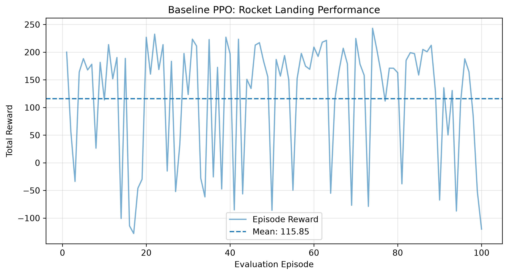

# Autonomous Rocket Landing Using Reinforcement Learning

A reinforcement learning project that trains an AI agent
to autonomously land a rocket in Gymnasium's LunarLander-v3
environment using Proximal Policy Optimization (PPO).

## Technologies
- Python
- Gymnasium
- Stable-Baselines3
- PyTorch
- Matplotlib
- Pandas

## Baseline Model
- Algorithm: PPO
- Training timesteps: 500,000
- Evaluation episodes: 100
- Average reward: 115.85
- Landing success proxy: 72%
- Average episode length: 498.5 steps

## Baseline Evaluation

## Future Experiments
- Implement custom reward shaping
- Investigate reward hacking
- Compare multiple reward functions
- Improve landing reliability
